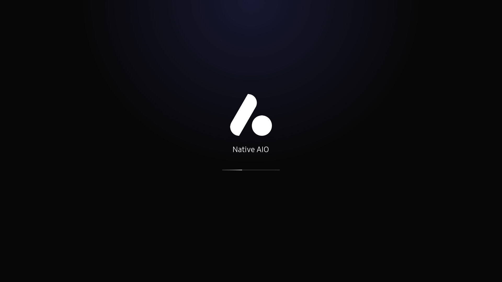
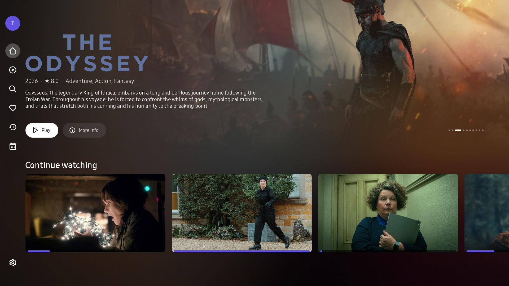
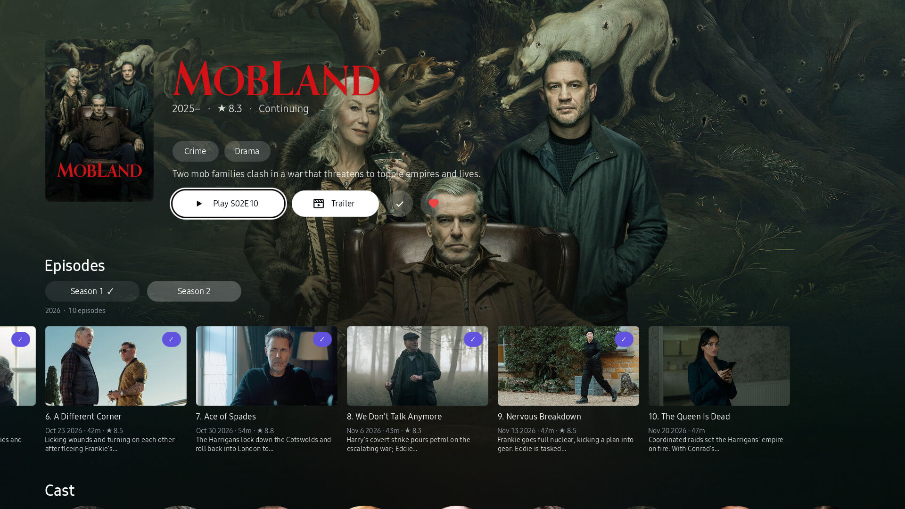
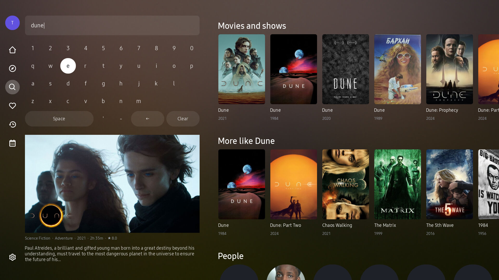

<p align="center">
  
</p>

# Native AIO

**Native AIO is an unofficial [AIOStreams](https://github.com/Viren070/AIOStreams) client for Samsung TVs (Tizen).**

It is a native .NET app, built to feel smooth on the TV remote. It talks to an AIOStreams server the way a Jellyfin app does, and takes its look and behaviour from the AIOStreams web app.

> This is a personal project, provided as is, without warranty of any kind.
> It is not affiliated with AIOStreams, Jellyfin or Samsung.

## Screenshots

| Home | Title page |
|---|---|
|  |  |
| **Player** | **Search** |
|  |  |

The player screenshot is a composite: the TV does not capture video, so the real player controls were laid over a still of the film.

## Features

- Sign-in by address, user name and password, or Quick Connect; "Who's watching?" for several users on one configuration.
- Sign-in with a phone: scan a QR code on the TV and type the server address and sign-in details (or use Quick Connect) on the phone instead of the remote.
- Home with a featured banner, "Continue watching", "Next up", "Upcoming" and the catalogue rows; cards open on focus and play their trailer.
- Title pages with seasons, episodes, cast, similar titles and collections; list of versions (streams) for each title.
- Native 4K player: audio and subtitle tracks, subtitles drawn by the app (style, offset, automatic sync), skip recap / intro / credits, next episode, resume.
- Search with an on-screen keyboard (QWERTY or AZERTY), Discover (catalogues and filters), Calendar, Favourites, History, person pages.
- Long press OK on a card for its menu (play, choose a version, mark watched, remove from "Continue watching", favourites).
- Settings that follow the AIOStreams web app, themes, English and French interface.
- Optional spoiler protection: episodes you haven't started show a blurred picture, without their title and description, until you select them.
- Crash report: after an unexpected close, the app offers a QR code that opens a prefilled GitHub issue on your phone. The TV sends nothing; you read the report before posting it.

## Requirements

- An AIOStreams server with its Jellyfin-compatible API ("Jellyfin apps" in the AIOStreams configuration).
- A Samsung TV running Tizen. Native AIO targets Tizen 6.0 (2021 models) and later. The author tests it on one 2021 model running Tizen 6.0. A user reports that it works on a 2024 model running Tizen 9 (exact model and extent of testing unknown). Other models and Tizen versions are untested.

## Install

Download `io.github.thomasrtg.nativeaio-<version>.tpk` from the [Releases](https://github.com/thomasrtg/native-aio/releases) page.

A Tizen package has to be signed with a certificate that the TV accepts, so it cannot be installed as is. The author installs it with **[Apps2Samsung](https://github.com/Apps2Samsung/Apps2Samsung)**, which finds the TV, creates the signing certificate and installs the package, without Tizen Studio:

1. Put the TV in **developer mode**: press Home, open Apps, type `1 2 3 4 5` with the remote, switch Developer Mode on and enter the IP address of the computer that runs Apps2Samsung (TV and computer on the same network).
2. **Restart the TV** completely (hold the power button until the logo shows, or unplug it for 30 seconds; standby is not enough).
3. In Apps2Samsung, choose the TV and install your own `.tpk` (the Native AIO file you downloaded).

Follow the Apps2Samsung documentation for the details: its steps may change.

## Build from source

You need the .NET 8 SDK and the Tizen .NET workload ([installation guide](https://github.com/Samsung/Tizen.NET/wiki/Installing-Tizen-.NET-Workload)).

```
cd src/NativeAIO
dotnet build -c Release
```

The package is written to `src/NativeAIO/bin/Release/tizen80/io.github.thomasrtg.nativeaio-<version>.tpk`. Install it as described above.

For development only, `dotnet build -c Release -p:Probe=true` builds a separate test package, `src/NativeAIO/bin/probe/Release/tizen80/io.github.thomasrtg.nativeaio-<version>-probe.tpk`, with a probe (`Core/Probe.cs`): a small HTTP server on `127.0.0.1:8123` that reads measures, simulates keys and captures the screen. Do not use it day to day and never publish it: any app on the TV could reach the probe.

## Security notes

- The sign-in token is stored in plain text in the app's preferences on the TV.
- Use an `https://` server address. With `http://` (or an address typed without a scheme, which is tried with `http://` like the web app), the token travels in clear text.
- Sign-in with a phone: while the QR code is shown, the TV runs a small web server on your local network (port 8125), protected by a one-time code in the QR code. It stops once signed in, when you leave the screen or after 10 minutes without a request. Between the phone and the TV, the address, user name and password travel in clear text over your local network; the TV does not keep the password, only the sign-in token, as with the remote.

## Credits

- [AIOStreams](https://github.com/Viren070/AIOStreams) by Viren070 (AGPL-3.0): the original project and the base of this work. Native AIO takes its look, texts, behaviour and several algorithms (YouTube trailers, subtitles) from the AIOStreams web app. The AIOStreams logo is used for the app icon and start screen.
- [Jellyfin](https://jellyfin.org): the API that AIOStreams exposes and that Native AIO speaks.
- Icons: [Lucide](https://github.com/lucide-icons/lucide) (ISC license) and [Boxicons](https://github.com/box-icons/boxicons) (MIT license).
- QR code generator based on the [Project Nayuki](https://www.nayuki.io/page/qr-code-generator-library) library (MIT license).
- Subtitle fonts: PT Serif, Cousine, Courier Prime and Comic Neue (SIL Open Font License 1.1); Satisfy (Apache License 2.0). Their licenses are in `src/NativeAIO/res/fonts`.
- [Apps2Samsung](https://github.com/Apps2Samsung/Apps2Samsung) (GPL-3.0), used to install the app on the TV.

## License

Native AIO is released under the [GNU Affero General Public License v3.0](LICENSE), like AIOStreams, whose code it adapts.
